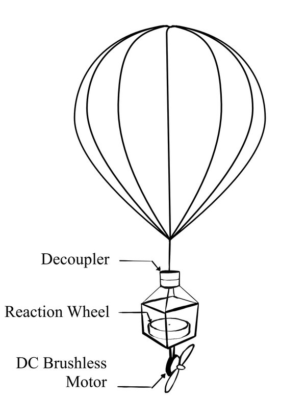
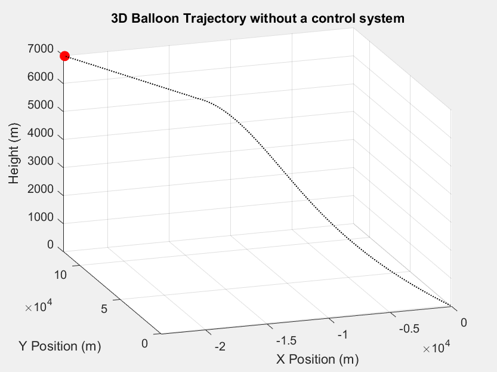
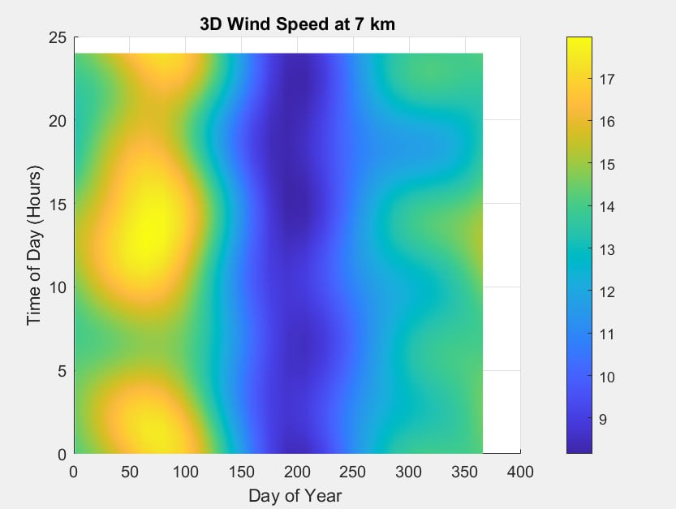
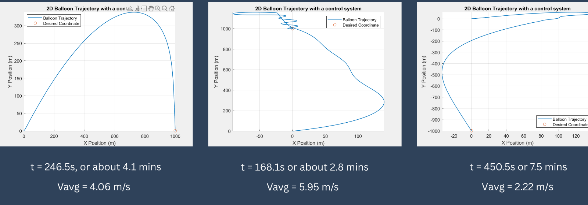
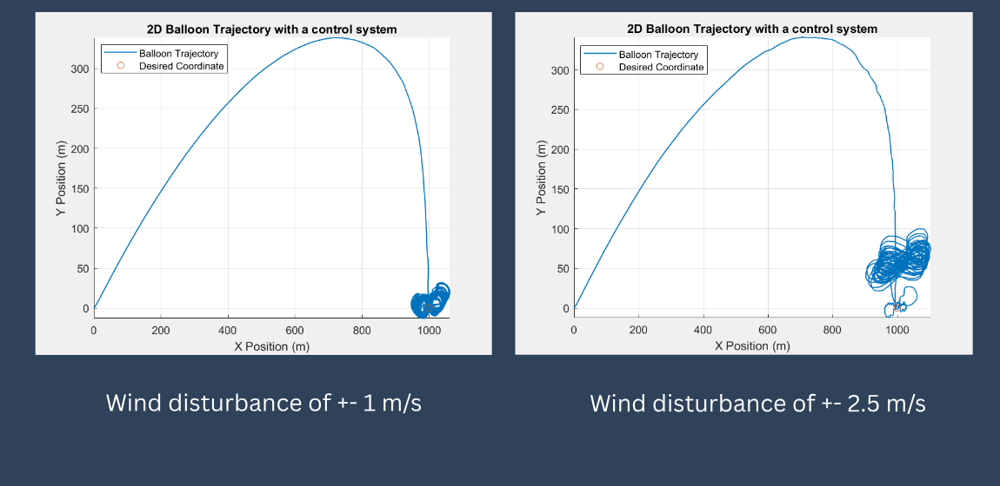
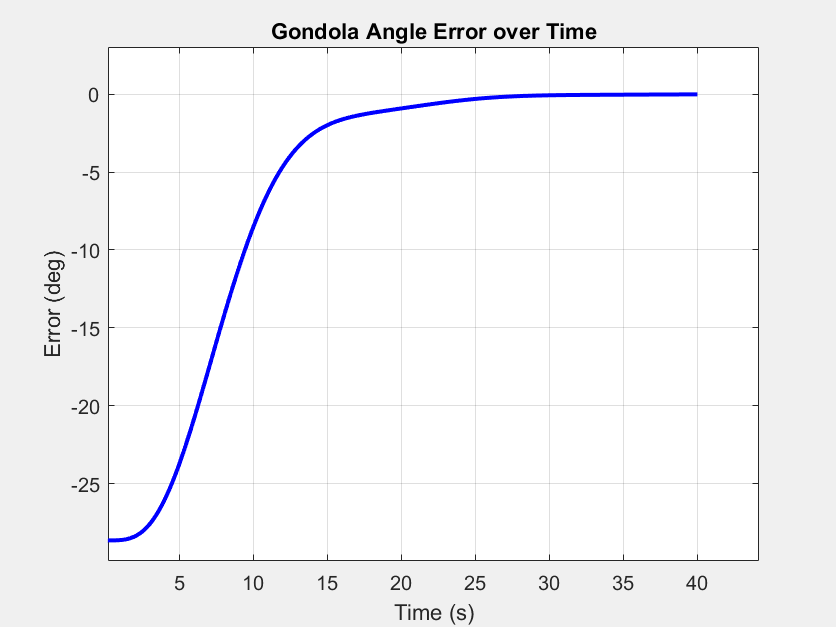
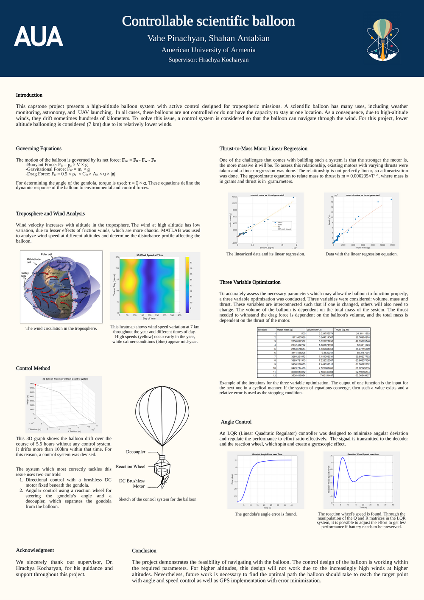

# Controllable High-Altitude Scientific Balloon

**BSc capstone, American University of Armenia (2025).** By Vahe Pinachyan and Shahan Antabian, supervised by Dr. Hrachya Kocharyan.

Scientific balloons are used for weather monitoring, astronomy and UAV launches, but they go wherever the wind takes them. In our simulation, an uncontrolled balloon at 7 km **drifted more than 100 km in 5.5 hours**. This project modelled a balloon at **7 km** in MATLAB and designed a **two-actuator control system** that lets it navigate to a target and hold position against wind:

1. **Speed and direction:** a brushless DC motor and propeller under the gondola, under **PID** thrust control.
2. **Heading:** a **reaction wheel** that rotates the gondola, with a decoupler separating it from the balloon. It was controlled with **PD**, and an **LQR** alternative was also designed.

 &nbsp; 

## What was done

**Wind analysis.** We used MATLAB's Horizontal Wind Model (`atmoshwm`) to map wind speed against altitude, day of year and time of day. The maps pick out low-wind flight windows: at 7 km the winds are calmest in mid-year.

**Dynamics model.** Vertical and horizontal motion follow from the net force $F_{net} = F_B - F_W - F_D$:

- buoyancy $F_B = \rho_a V g$
- weight $F_W = m_t g$
- drag $F_D = \tfrac12 \rho_a C_D A_B\  u|u|$

Gondola rotation follows $\tau = I\alpha$.

**System sizing.** A stronger motor is heavier, and that changes the whole balloon:

- **Motor regression.** Fitting data from real brushless motors gave $m \approx 0.006235\ T^{1.2}$, with m in grams and T in g·m.
- **Three-variable fixed-point optimisation.** Balloon volume, total mass and required thrust were solved together. The volume depends on the mass, the thrust needed against drag depends on the volume, and the mass depends on the motor's thrust. The iteration converged in **14 iterations**.

**Control and simulation at 7 km.**

| Result | |
|---|---|
| **PID thrust + PD heading.** Targets 1 km away are reached in **2.8–7.5 min**, depending on direction relative to the wind. |  |
| **Random wind gusts of ±1 m/s and ±2.5 m/s.** The balloon reaches the target and then stays within roughly 100 m of it. |  |
| **LQR heading control.** The gondola error goes from −28° to 0 in about 20 s. Tuning Q and R trades pointing performance against reaction-wheel effort, which matters for the battery budget. |  |

## Conclusion

Navigating a scientific balloon at 7 km is feasible with this two-actuator design. At higher altitudes the winds become too strong for it. Next steps would be path planning to the target, GPS-based guidance, solar power and a fully automated system.

## Documents

- [Poster (PDF)](docs/poster.pdf)
- [Slides (PDF)](docs/slides.pdf)

